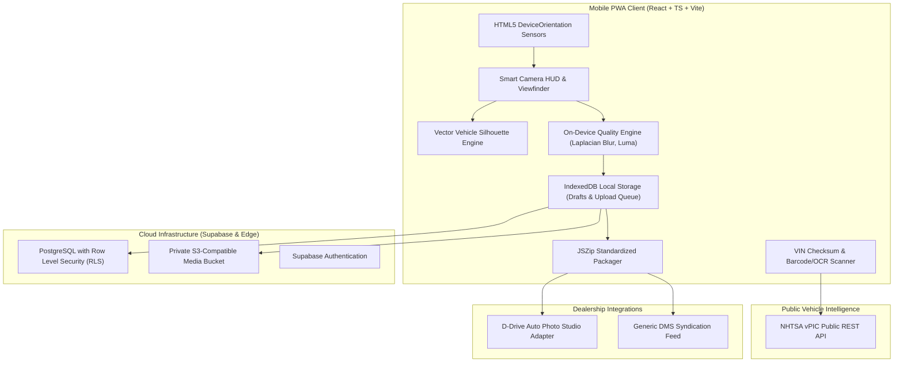

> Historical V1 planning document. Current implementation, disabled cloud/integrations, and unrun physical acceptance are documented in [CODEX_HANDOFF.md](CODEX_HANDOFF.md). Do not interpret historical launch or verification claims as V2 evidence.

# Smart Capture — Technical Architecture

## 1. System Overview

Smart Capture is a standalone, mobile-first, Progressive Web Application (PWA) engineered to solve visual inconsistency in dealership automotive photography. Designed for harsh car-lot environments (bright direct sunlight, poor cellular reception, high lot turnover), the architecture couples client-side computer vision heuristics with an offline-first storage engine and strict multi-tenant cloud synchronization.

## 2. Core Architectural Principles

1. **Standalone & Independent**: Smart Capture operates as an autonomous SaaS product with its own multi-tenant database and isolated storage. It does not depend on D-Drive Auto's infrastructure.
2. **Offline-First Resilience**: Car lots frequently suffer from connectivity dead-zones. Every photograph, session draft, and template configuration is stored immediately in IndexedDB via `idb`. Photographs are queued for background upload when network is restored.
3. **High-Ergonomic Mobile UX**: Dark charcoal theme (`#0B0D11`), high-contrast HUD overlays, 48px+ touch targets, single-handed shutter positioning, and clear status badges.
4. **Deterministic Client Quality Analysis**: Image sharpness (Laplacian variance), exposure thresholds, and horizon tilt angles are evaluated in under 25 milliseconds via lightweight canvas sampling without server roundtrips.
5. **No Secret Leaks**: Zero service-role keys or production secrets in client bundles. Access control is enforced via PostgreSQL Row Level Security (RLS) policies.
