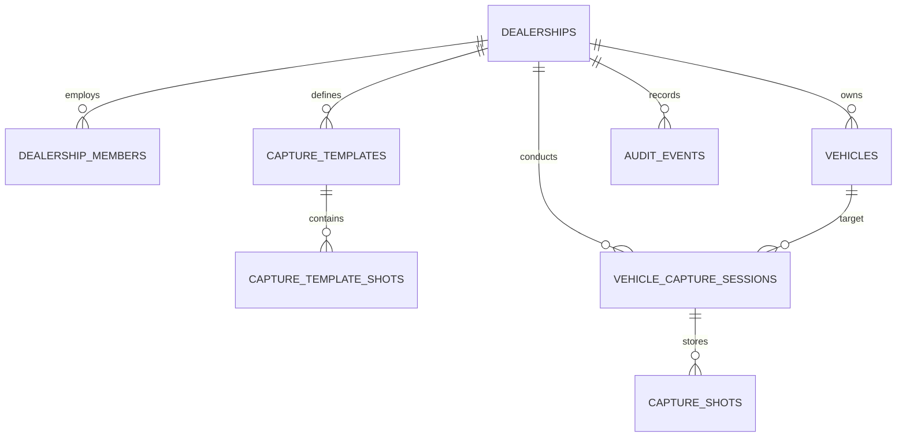

# Database Architecture & Row Level Security (RLS)

## 1. Schema Overview

The database is built on PostgreSQL with additive migration scripts located in `supabase/migrations/`. It enforces complete tenant isolation across dealerships, members, vehicles, capture sessions, and media assets.



## 2. Table Definitions

### 2.1 `dealerships`
Represents an independent dealer rooftop or group branch.
- `id`: UUID (Primary Key)
- `name`: TEXT (Dealership legal or business name)
- `slug`: TEXT (Unique URL identifier)
- `plan_id`: TEXT (`basic`, `pro`, `dealer_group`)
- `monthly_vehicle_quota`: INT (Default: 50)
- `storage_quota_gb`: INT (Default: 5)
- `storage_used_mb`: NUMERIC(10, 2)

### 2.2 `dealership_members`
Multi-tenant user memberships linked to authenticated user accounts.
- `id`: UUID (Primary Key)
- `dealership_id`: UUID (Foreign Key -> dealerships.id)
- `user_id`: UUID (Foreign Key -> auth.users.id)
- `email`: TEXT
- `full_name`: TEXT
- `role`: TEXT (`platform_admin`, `owner`, `manager`, `photographer`)
- `is_active`: BOOLEAN

### 2.3 `vehicles`
Inventory vehicles linked to a dealership.
- `id`: UUID (Primary Key)
- `dealership_id`: UUID (Foreign Key -> dealerships.id)
- `vin`: TEXT (17-digit ISO VIN)
- `year`, `make`, `model`, `trim`: TEXT / INT
- `body_style`: TEXT (`sedan`, `suv`, `truck`, `coupe`, `convertible`, `van`, etc.)
- `stock_number`: TEXT

### 2.4 `capture_templates` & `capture_template_shots`
Customizable photography standards defined by dealership management.
- `id`: UUID (Primary Key)
- `dealership_id`: UUID (Foreign Key -> dealerships.id)
- `name`: TEXT (e.g. "D-Drive 20-Shot Premium")
- `shots`: Ordered list of required and optional angles with individual guidance text and distance recommendations.

### 2.5 `vehicle_capture_sessions` & `capture_shots`
Individual lot photography jobs and captured image assets.
- `id`: UUID (Primary Key)
- `dealership_id`: UUID (Foreign Key -> dealerships.id)
- `vehicle_id`: UUID (Foreign Key -> vehicles.id)
- `status`: TEXT (`in_progress`, `completed`, `pending_upload`, `archived`)
- `shots`: Individual photo metadata (storage path, blur score, exposure, tilt degrees, hero flag).

## 3. Row Level Security (RLS) Policies

Every table has Row Level Security enabled. Security helper function:

```sql
CREATE OR REPLACE FUNCTION current_user_has_dealership_access(target_dealership_id UUID)
RETURNS BOOLEAN AS $$
BEGIN
  RETURN EXISTS (
    SELECT 1 FROM dealership_members
    WHERE dealership_id = target_dealership_id
      AND user_id = auth.uid()
      AND is_active = TRUE
  );
END;
$$ LANGUAGE plpgsql SECURITY DEFINER;
```

RLS Policy ensures cross-tenant isolation:
```sql
CREATE POLICY vehicles_dealership_isolation ON vehicles
  FOR ALL
  USING (current_user_has_dealership_access(dealership_id));
```
One dealership cannot read, update, or delete vehicles, templates, or media belonging to another dealership under any circumstances.
