# Smart Capture — Product Roadmap

```mermaid
flowchart LR
    M1["M1: Architecture & GitHub Actions"] --> M2["M2: Working Mobile Camera"]
    M2 --> M3["M3: Guided Silhouette Engine"]
    M3 --> M4["M4: VIN & NHTSA Decoding"]
    M4 --> M5["M5: Offline IDB & Gallery"]
    M5 --> M6["M6: Photo Quality Engine"]
    M6 --> M7["M7: D-Drive Adapter"]
    M7 --> M8["M8: SaaS & Launch"]
    M8 --> M9["M9: On-Device CV Alignment"]
```

## Milestone Status Overview

| Milestone | Scope | Status | Verification |
| --- | --- | --- | --- |
| **M1: Architecture & Repo** | Public GitHub repo, Vite, React, Tailwind, GitHub Actions workflows A-I | **COMPLETED** | Passing CI, Lint, Format, Build |
| **M2: Mobile Camera Engine** | MediaStream, rear/front camera switching, torch, focus, orientation | **COMPLETED** | Verified in mobile viewports |
| **M3: Guided Capture Overlays** | Original vector silhouettes for Sedan, SUV, Truck, Coupe, Interior, HUD | **COMPLETED** | Verified SVG render & scale |
| **M4: VIN & Vehicle Engine** | ISO 3779 checksum, NHTSA vPIC decoder, BodyStyle inference, scanner | **COMPLETED** | 100% Vitest unit tests passing |
| **M5: Storage & Gallery** | IndexedDB offline persistence, gallery reordering, hero shot, ZIP packager | **COMPLETED** | Verified local IDB & JSZip |
| **M6: Photo Quality Engine** | Laplacian blur check, luminance histogram, horizon tilt calculation | **COMPLETED** | Verified deterministic tests |
| **M7: Integration Adapter** | D-Drive Photo Studio adapter, DMS CSV/JSON export specifications | **COMPLETED** | Adapter client & typed sync |
| **M8: SaaS Foundation & Launch** | Multi-tenant schema with RLS, landing page, responsive matrix tests | **COMPLETED** | Playwright E2E passing all viewports |
| **M9: Advanced CV Research** | On-device TensorFlow.js / WebAssembly vehicle boundary segmentation | **RESEARCH PHASE** | Documented in `docs/architecture.md` |

## Future Expansion (Post-Pilot)

1. **Native PWA Background Sync**: When Web Background Synchronization API reaches parity on iOS WebKit.
2. **Automated AI Background Replacement**: Cloud-based studio turntable background segmentation (optional premium add-on tier).
3. **DealerCenter & Frazer Direct DMS API Connectors**: Certified partner integrations upon API credential provisioning.
4. **Stripe Billing Integration**: Automated self-serve credit card billing for Basic ($39) and Pro ($79) plans.
