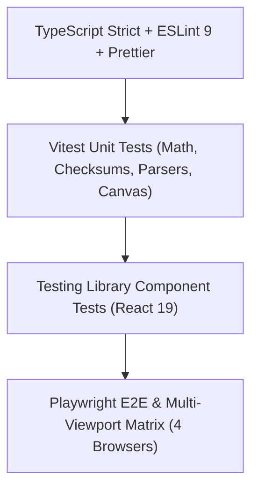

# Quality Assurance & Testing Strategy

Smart Capture utilizes a multi-layered verification pyramid: static analysis, typechecking, unit tests, component tests, and multi-viewport end-to-end browser tests.



## 1. Test Suites

### 1.1 Unit Tests (Vitest)
- `tests/unit/vinValidator.test.ts`: ISO 3779 checksum calculation, transliteration weights, Modulus 11 check digit verification, forbidden character handling, OCR substitution suggestions.
- `tests/unit/nhtsaDecoder.test.ts`: NHTSA vPIC JSON parsing, BodyStyle inference mapping, network failure fallbacks.
- `tests/unit/defaultTemplates.test.ts`: Master 24-shot sequence, D-Drive 20-shot inventory standard, truck bed and convertible roof adaptations.
- `tests/unit/qualityEngine.test.ts`: Laplacian variance blur calculation, histogram luminance exposure analysis, horizon tilt level calculation, resolution checks.
- `tests/unit/zipExporter.test.ts`: Standardized ordered ZIP archive generation, `manifest.json` and `manifest.csv` formatting.

### 1.2 Component Tests (React Testing Library)
- `tests/unit/components.test.tsx`:
  - `OverlayControls`: HUD opacity adjustments, outline toggling, color presets, horizon guides.
  - `QualityWarningBanner`: Advisory display with "Retake Shot" and "Keep Anyway" buttons.
  - `VinLookupForm`: Manual vehicle entry and template assignment.

### 1.3 End-to-End Tests (Playwright)
- `tests/e2e/capture-flow.spec.ts`:
  - End-to-end vehicle capture journey: Dashboard -> VIN Entry -> NHTSA Decode -> Body Selection -> Guided Smart Camera -> Shutter Capture -> Review Mode -> Sequence Advance -> Gallery Review -> ZIP Package Export.
  - Tested across 4 distinct viewports:
    - **Desktop Chrome** (1280x720)
    - **Mobile Chrome Pixel 7** (393x851)
    - **Mobile Safari iPhone 14** (390x844)
    - **Tablet iPad Mini** (768x1024)

## 2. Running Test Commands Locally

```bash
# Run unit & component tests
npm test

# Run tests with coverage
npm run test:coverage

# Run Playwright E2E tests
npm run test:e2e

# Run TypeScript typecheck
npx tsc --noEmit

# Run ESLint analysis
npm run lint

# Run code style formatting check
npm run format:check
```
